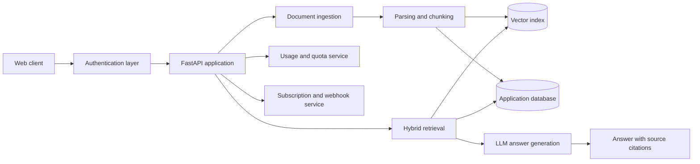

# Atlas: Engineering a Multi-Tenant Document Intelligence Platform

[Live product](https://rag-frontend-eyeg.onrender.com/) · [API documentation](https://atlas-rag-docs.duckdns.org/docs) · [Portfolio case study](https://dhiranreddy.cyou/#work)

Atlas is a document intelligence platform for asking questions across private files and tracing answers back to their sources. I built it as an end-to-end engineering project to explore what it takes to move a RAG application beyond a single-user demonstration.

> This repository is a public engineering case study. The production source code, infrastructure configuration, prompts, and secrets remain private.

## The problem

Basic RAG demonstrations often stop after document upload and similarity search. A usable product also needs tenant isolation, identity, ingestion controls, persistent conversations, usage limits, payment state, failure handling, and source-grounded responses.

Atlas was designed around those additional constraints.

## System overview

The diagram is intentionally technology-level rather than deployment-specific. Production network details and configuration are not published.

## Core capabilities

- Upload and process PDF, DOCX, TXT, Markdown, and CSV files
- Combine vector and lexical retrieval
- Generate conversational answers with source references
- Preserve conversation history
- Isolate documents and usage by authenticated user or workspace
- Enforce per-user quotas
- Support email OTP and OAuth-based authentication flows
- Process Razorpay payment and subscription webhooks
- Expose the backend through a documented REST API

## Engineering decisions

### Hybrid retrieval instead of vector search alone

Semantic search is useful for conceptual similarity, but it can underperform for exact identifiers, names, and domain-specific terms. Atlas combines semantic and lexical signals so that retrieval is not dependent on a single ranking method.

### Citations are part of the response contract

The retrieval layer retains source metadata through chunking and ranking. The response schema returns supporting source information alongside the generated answer, allowing the client to present evidence rather than an untraceable response.

### Tenant context is established server-side

Document access, conversation history, quotas, and subscription state are resolved from authenticated identity. Client-supplied ownership identifiers are not treated as authorization.

### Payments are event-driven

Subscription state is updated through verified webhook events. Payment success is not inferred only from a browser redirect or a client-provided value.

## Public interface

The public API documentation demonstrates implemented routes for:

- Account registration, login, OTP verification, and OAuth exchange
- Document upload, listing, and deletion
- Retrieval and question answering
- Usage reporting
- Payment creation, verification, and webhook handling
- Service health checks

The interactive documentation is evidence of the interface, not an invitation to exercise destructive or administrative operations.

## Security boundary

The public case study does **not** include:

- Credentials, tokens, connection strings, or `.env` files
- Production infrastructure configuration or network topology
- Complete retrieval and ranking implementation
- Proprietary prompts or evaluation data
- Payment secrets or webhook signing material
- Private user documents or production data

## Evaluation approach

Retrieval and answer quality should be measured with a versioned test set rather than marketing claims. The evaluation plan covers:

1. Retrieval relevance for exact and semantic queries
2. Citation correctness and source coverage
3. Unsupported-claim detection
4. Cross-tenant access tests
5. Parsing failures across supported file formats
6. Latency by ingestion and query stage

Measured results will be published only when the dataset, methodology, and sample size can be described alongside them.

## What I learned

- A reliable RAG product is primarily a data, identity, and evaluation system—not just an LLM call.
- Source metadata must survive every transformation or citations become cosmetic.
- Tenant isolation must be designed into storage and query boundaries from the beginning.
- Usage controls and failure states shape the user experience as much as answer quality.
- Public product claims should be traceable to a reproducible measurement.

## Status

Atlas is an independently built portfolio product. The live deployment may use resource-saving infrastructure and can take time to wake after inactivity.

